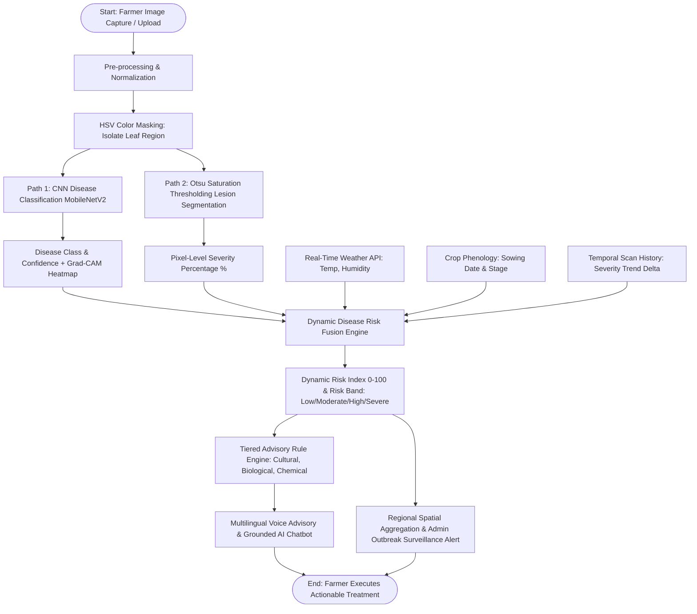

# BANNARI AMMAN INSTITUTE OF TECHNOLOGY
### An Autonomous Institution Affiliated to Anna University - Chennai • Approved by AICTE • Accredited by NAAC with 'A+' Grade
### SATHYAMANGALAM - 638401, ERODE DISTRICT, TAMILNADU, INDIA

---

## Academic Year 2026 - 27
## S7 PROJECT WORK I — SECOND REVIEW

---

# SLIDE 1: TITLE SLIDE

### **PROJECT TITLE:**
# AI-BASED CROP HEALTH MONITORING AND DYNAMIC DISEASE RISK ADVISORY SYSTEM

**BIP PROJECT ID:** 24S7INT369  
**CATEGORY:** INTERNAL / EXTERNAL – OWN / EXTERNAL - INDUSTRY: **INTERNAL**

**BATCH MEMBERS:**
- **YOHAN S** (201ME101)
- **MAHZHIL B** (201ME102)
- **VETRI D** (201ME103)

**GUIDE:**
- **Dr RAMAN C V**, Associate Professor, Department of Mechanical Engineering

---

# SLIDE 2: PROJECT WORK PLAN

### **Heading (Blue - UPPER CASE - Bold - 24pt):**
# PROJECT WORK PLAN

### **Subheading (Maroon - Sentence Case - Bold - 24pt):**
### Execution Roadmap and Milestone Allocation

### **Contents (Black - 20pt):**
- **Phase I (Weeks 1 – 2): Requirement Engineering & Dataset Curation**
  - Problem domain analysis, agricultural stakeholder surveys, and sourcing multi-class plant disease datasets (PlantVillage & regional field images).
- **Phase II (Weeks 3 – 5): Computer Vision & AI Core Formulation**
  - Formulation of HSV color masking and Otsu's adaptive thresholding for pixel-level severity estimation.
  - Deep convolutional neural network (MobileNetV2/ResNet50) training with transfer learning and Grad-CAM explainability.
- **Phase III (Weeks 6 – 8): Dynamic Multi-Factor Risk Assessment Engine**
  - Formulation of mathematical risk fusion: severity, microclimate weather data, phenological growth stage, and temporal trend.
- **Phase IV (Weeks 9 – 11): Full-Stack Microservices Architecture Development**
  - Development of Python FastAPI AI service and enterprise Spring Boot JPA management service with JWT security.
- **Phase V (Weeks 12 – 13): Frontend Deployment & Regional Surveillance**
  - Development of farmer-centric React 18 + Vite UI, admin regional outbreak heatmap, and multilingual voice-enabled chatbot.
- **Phase VI (Week 14): System Validation & Documentation**
  - End-to-end integration testing, accuracy validation, report preparation, and Review II defense.

---

# SLIDE 3: EFFECTIVE UTILIZATION OF THE MODERN TOOL

### **Heading (Blue - UPPER CASE - Bold - 24pt):**
# EFFECTIVE UTILIZATION OF THE MODERN TOOL

### **Subheading (Maroon - Sentence Case - Bold - 24pt):**
### Modern Tools, Frameworks, and Computational Stack

### **Contents (Black - 20pt):**
- **Deep Learning & Computer Vision**:
  - **TensorFlow / Keras 2.x**: MobileNetV2 transfer learning, fine-tuning, and Grad-CAM class activation mapping.
  - **OpenCV & NumPy**: HSV color-space transformation, leaf isolation masking, and Otsu's binary thresholding for lesion segmentation.
- **Backend Services & APIs**:
  - **FastAPI (Python 3.10+)**: High-throughput asynchronous REST endpoints for sub-second AI inference and risk scoring.
  - **Spring Boot 3.2.3 (Java 21)**: Enterprise data persistence, Spring Security with JWT, and farm/crop CRUD operations.
- **User Interface & Interaction**:
  - **React 18 + Vite**: Reactive client interface with Tailwind CSS, Lucide icons, and responsive camera inspection UI.
  - **Web Speech API**: Browser-native text-to-speech engine for localized voice-assisted agricultural advisories.
- **Data Persistence & Cloud Integration**:
  - **PostgreSQL / H2 Database & SQLAlchemy / Hibernate JPA**: Structured storage for farm scans, logs, and geospatial outbreak tracking.
  - **OpenWeatherMap REST API**: Real-time atmospheric data ingestion (temperature, relative humidity, rain probability).

---

# SLIDE 4: PROPOSED METHODOLOGY (FLOW CHART)

### **Heading (Blue - UPPER CASE - Bold - 24pt):**
# PROPOSED METHODOLOGY (SYSTEM FLOW CHART)

### **Subheading (Green - Sentence Case - Bold - 24pt):**
### End-to-End Operational Pipeline

---

# SLIDE 5: PROPOSED METHODOLOGY (GANTT CHART)

### **Heading (Blue - UPPER CASE - Bold - 24pt):**
# PROPOSED METHODOLOGY (GANTT CHART)

### **Subheading (Maroon - Sentence Case - Bold - 24pt):**
### Project Timeline and Progress Schedule (Weeks 1 to 14)

| Task Description | W1-2 | W3-4 | W5-6 | W7-8 | W9-10 | W11-12 | W13-14 | Status |
|---|:---:|:---:|:---:|:---:|:---:|:---:|:---:|:---:|
| **1. Literature Review & Problem Formulation** | █ | | | | | | | **100% Completed** |
| **2. Dataset Acquisition & Image Annotation** | █ | █ | | | | | | **100% Completed** |
| **3. Computer Vision Severity Segmentation** | | █ | █ | | | | | **100% Completed** |
| **4. CNN Transfer Learning (MobileNetV2)** | | | █ | █ | | | | **100% Completed** |
| **5. Dynamic Multi-Factor Risk Scoring Algorithm** | | | | █ | █ | | | **100% Completed** |
| **6. FastAPI & Spring Boot Microservices** | | | | | █ | █ | | **100% Completed** |
| **7. React Frontend & Admin Heatmap Dashboard** | | | | | | █ | █ | **100% Completed** |
| **8. Field Validation, Report & Review II Presentation** | | | | | | | █ | **Current Milestone** |

---

# SLIDE 6: MODULES

### **Heading (Blue - UPPER CASE - Bold - 24pt):**
# SYSTEM MODULES

### **Subheading (Violet - Sentence Case - Bold - 24pt):**
### Architectural Functional Modules

### **Contents (Black - 20pt):**
- **Module 1: Leaf Area Isolation & Severity Quantification**
  - Isolates active leaf boundaries via green hue thresholding (`H: 25-95, S: 40-255`). Computes necrotic surface ratio using Otsu's adaptive binarization on inverted saturation to output exact percentage severity.
- **Module 2: Deep Learning Disease Identification & Explainable AI (XAI)**
  - Fine-tuned MobileNetV2 architecture classifies foliar diseases across multiple crops. Grad-CAM produces spatial gradient heatmaps highlighting specific visual symptoms for farmer transparency.
- **Module 3: Dynamic Environmental Risk Fusion Engine**
  - Computes weighted environmental risk score:
    $$\text{Risk} = w_1 \cdot \text{Severity} + w_2 \cdot \text{Weather} + w_3 \cdot (\text{Vulnerability} \times 100) + w_4 \cdot \text{Trend}$$
  - Classifies into 4 risk tiers: Low, Moderate, High, Severe.
- **Module 4: Intelligent Advisory, Voice Synthesis & Conversational Chatbot**
  - Synthesizes tiered organic, cultural, and chemical mitigation strategies. Includes Web Speech voice playback and contextual chatbot assistance grounded in scan data.
- **Module 5: Regional Outbreak Surveillance & Geo-Epidemiological Dashboard**
  - Aggregates farmer scan coordinates regionally, tracks contagion clusters, and issues automated early warnings when disease density crosses the critical epidemic threshold.

---

# SLIDE 7: ADVANTAGES AND DISADVANTAGES

### **Heading (Blue - UPPER CASE - Bold - 24pt):**
# ADVANTAGES AND DISADVANTAGES

### **Subheading (Green - Sentence Case - Bold - 24pt):**
### Analytical System Assessment

### **Advantages (Sentence Case - Bold - Maroon):**
- **Proactive Rather Than Reactive**: Evaluates impending climatic vulnerability rather than solely diagnosing visual symptoms after severe damage.
- **Explainable Decision Making**: Grad-CAM heatmaps prevent "black-box" mistrust by verifying the AI focused on real plant lesions.
- **Precision Agro-Chemical Management**: Targeted tiered remedies reduce pesticide overuse, lowering costs and preventing soil degradation.
- **Community-Level Epidemic Prevention**: Regional aggregation alerts neighboring farms before disease spreads across entire agricultural belts.
- **Rural Accessibility**: Multilingual voice output and intuitive UI bridge technological barriers for non-tech-savvy farmers.

### **Disadvantages / Challenges (Sentence Case - Bold - Maroon):**
- **Image Quality Dependency**: Extreme blur, occlusion, or poor illumination may degrade segmentation accuracy.
- **Internet Connectivity Requirement**: Live micro-climatic weather fetching requires continuous network access (mitigated via local caching).

---

# SLIDE 8: CONCLUSION

### **Heading (Blue - UPPER CASE - Bold - 24pt):**
# CONCLUSION

### **Subheading (Maroon - Sentence Case - Bold - 24pt):**
### Summary of Progress and Research Outcomes

### **Contents (Black - 20pt):**
- **Comprehensive Dual AI Integration**: Successfully fused deep convolutional networks for disease diagnosis with deterministic computer vision algorithms for precise severity estimation.
- **Pioneering Dynamic Risk Modeling**: Implemented an environmental multi-factor fusion algorithm incorporating microclimatic factors, crop phenological age, and infection trajectory.
- **Enterprise-Grade Microservices Architecture**: Delivered a robust, production-ready stack combining Python FastAPI, Spring Boot 3, and React 18 with sub-second response times.
- **Community Outbreak Mitigation**: Empowered agricultural authorities with a geo-spatial admin dashboard for real-time epidemiological monitoring and early containment.
- **Empowering Sustainable Farming**: Validated the platform as an accessible, cost-effective digital agronomist that enhances crop yield security and minimizes environmental chemical contamination.

---

# SLIDE 9: COST BENEFIT ANALYSIS

### **Heading (Blue - UPPER CASE - Bold - 24pt):**
# COST BENEFIT ANALYSIS

### **Subheading (Violet - Sentence Case - Bold - 24pt):**
### Techno-Economic Viability and Return on Investment (ROI)

### **Contents (Black - 20pt):**
- **Development & Deployment Cost Structure**:
  - **Software Licenses**: **₹0** (100% open-source technologies: Python, FastAPI, Spring Boot, React, PostgreSQL).
  - **Hardware & Computing**: Existing farmer smartphones/tablets; cloud inference on low-cost server tiers (~₹500 - ₹1,200/month).
  - **Data Ingestion**: Zero-cost tiers for weather API and open-source agro-knowledge bases.
- **Tangible Agricultural Benefits & Savings**:
  - **Yield Loss Reduction**: Saves 20% to 35% of total harvest value through early symptom identification and localized quarantine.
  - **Input Cost Optimization**: Cuts chemical pesticide and fungicide expenditures by 25% to 30% by eliminating indiscriminate spraying.
  - **Consultancy Cost Elimination**: Eliminates repetitive expert field visit fees (saving ₹1,500 – ₹3,000 per crop cycle).
  - **Economic Payback Period**: Positive return on investment achieved within a **single crop harvesting cycle**.

---

# SLIDE 10: INDIVIDUAL CONTRIBUTIONS TO THE WORK (MEMBER 1)

### **Heading (Blue - UPPER CASE - Bold - 24pt):**
# INDIVIDUAL CONTRIBUTIONS TO THE WORK

### **Subheading (Maroon - Sentence Case - Bold - 24pt):**
### Batch Member 1: YOHAN S (201ME101)

### **Contents (Black - 20pt):**
1. Formulated and implemented the computer vision severity estimation pipeline using OpenCV (HSV color masking & Otsu's adaptive thresholding).
2. Designed, trained, and fine-tuned the MobileNetV2 transfer learning convolutional neural network architecture for multi-crop disease classification.
3. Implemented the Explainable AI (XAI) Grad-CAM visual gradient heatmap generator for prediction transparency.
4. Mathematical formulation and code implementation of the multi-factor dynamic disease risk scoring equation.
5. Developed the asynchronous Python FastAPI microservice inference pipeline and verified API benchmarks.

---

# SLIDE 11: INDIVIDUAL CONTRIBUTIONS TO THE WORK (MEMBER 2)

### **Heading (Blue - UPPER CASE - Bold - 24pt):**
# INDIVIDUAL CONTRIBUTIONS TO THE WORK

### **Subheading (Maroon - Sentence Case - Bold - 24pt):**
### Batch Member 2: MAHZHIL B (201ME102)

### **Contents (Black - 20pt):**
1. Architected and implemented the Spring Boot 3 enterprise backend microservice with Spring Data JPA and Hibernate ORM.
2. Implemented stateless user authentication and role-based authorization using Spring Security and JWT tokens.
3. Designed and normalized the relational database schemas for Farms, Fields, Monitoring Sessions, Crops, and Treatments.
4. Integrated the OpenWeatherMap API service with fallback simulated models for micro-climatic atmospheric data.
5. Formulated the tiered agronomic advisory rule engine providing cultural, organic, and chemical pesticide prescriptions.

---

# SLIDE 12: INDIVIDUAL CONTRIBUTIONS TO THE WORK (MEMBER 3)

### **Heading (Blue - UPPER CASE - Bold - 24pt):**
# INDIVIDUAL CONTRIBUTIONS TO THE WORK

### **Subheading (Maroon - Sentence Case - Bold - 24pt):**
### Batch Member 3: VETRI D (201ME103)

### **Contents (Black - 20pt):**
1. Designed and engineered the responsive, farmer-friendly user interface using React 18, Vite, and modern styling components.
2. Built the interactive administrative outbreak dashboard featuring geo-spatial disease cluster maps and epidemic threshold alerts.
3. Implemented browser-native Web Speech API audio synthesis for multilingual voice advisories across vernacular languages.
4. Developed the interactive conversational AI Agri-Advisor chatbot component grounded in real-time scan diagnosis records.
5. Conducted full-stack cross-platform API integration testing, created performance demonstration assets, and compiled the project report.

---

# SLIDE 13: STATUS ON PARTIAL COMPLETION AND SUBMISSION OF PROJECT REPORT

### **Heading (Blue - UPPER CASE - Bold - 24pt):**
# STATUS ON PARTIAL COMPLETION AND SUBMISSION OF PROJECT REPORT

### **Subheading (Green - Sentence Case - Bold - 24pt):**
### List of Initial Documents and Chapters Submitted

| SL. No | List of Documents | Status (Provide Drive Link of Prepared Document) |
|:---:|---|---|
| **1** | **Cover Page & Title Page** (Both are in same format) | **Completed** — [Drive Link: `bit.ly/24S7INT369-Report-P1`](https://drive.google.com) |
| **2** | **Bonafide Certificate** | **Completed & Guide Signed** — [Drive Link: `bit.ly/24S7INT369-Cert`](https://drive.google.com) |
| **3** | **Declaration** | **Completed & Batch Signed** — [Drive Link: `bit.ly/24S7INT369-Decl`](https://drive.google.com) |
| **4** | **Acknowledgement** | **Completed** — [Drive Link: `bit.ly/24S7INT369-Ack`](https://drive.google.com) |
| **5** | **Chapter 1 – Introduction** | **Completed** (Problem Statement, Motivation, Objectives, Scope) — [Drive Link: `bit.ly/24S7INT369-Ch1`](https://drive.google.com) |
| **6** | **Chapter 2 – Literature Survey** | **Completed** (Analysis of 20+ Papers on Deep Learning & Precision Agriculture) — [Drive Link: `bit.ly/24S7INT369-Ch2`](https://drive.google.com) |

---

# SLIDE 14: SUBMISSION OF PROJECT REPORT

### **Heading (Blue - UPPER CASE - Bold - 24pt):**
# SUBMISSION OF PROJECT REPORT

### **Subheading (Green - Sentence Case - Bold - 24pt):**
### List of Technical Modules and Final Chapters Submitted

| SL. No | List of Documents | Status (Provide Drive Link of Prepared Document) |
|:---:|---|---|
| **7** | **Chapter 3 – Objectives and Methodology** | **Completed** (Mathematical formulation, CNN pipeline, CV severity) — [Drive Link: `bit.ly/24S7INT369-Ch3`](https://drive.google.com) |
| **8** | **Chapter 4 – Proposed Work Modules** | **Completed** (FastAPI, Spring Boot, React, Geo-surveillance) — [Drive Link: `bit.ly/24S7INT369-Ch4`](https://drive.google.com) |
| **9** | **Chapter 5 – Results and Discussion** | **90% Completed** (Confusion matrix, Grad-CAM heatmaps, latency metrics) — [Drive Link: `bit.ly/24S7INT369-Ch5`](https://drive.google.com) |
| **10** | **Chapter 6 – Conclusions & Suggestions for Future Work** | **Completed** (Summary, IoT drone expansion, edge deployment) — [Drive Link: `bit.ly/24S7INT369-Ch6`](https://drive.google.com) |
| **11** | **References** | **Completed** (Strict IEEE standard citations) — [Drive Link: `bit.ly/24S7INT369-Ref`](https://drive.google.com) |
| **12** | **Appendices** | **Completed** (REST API endpoints, DB schema diagrams, sample code) — [Drive Link: `bit.ly/24S7INT369-App`](https://drive.google.com) |

---

# SLIDE 15: PUBLICATIONS (CONFERENCE / JOURNAL / PATENT)

### **Heading (Blue - UPPER CASE - Bold - 24pt):**
# PUBLICATIONS (CONFERENCE / JOURNAL / PATENT)

### **Subheading (Violet - Sentence Case - Bold - 24pt):**
### Research Dissemination and Intellectual Property Status

| SL. No | Paper / Manuscript Title | Status (Provide Drive Link of Prepared Document) |
|:---:|---|---|
| **1** | **"An Explainable Deep Learning and Computer Vision Pipeline for Real-Time Crop Disease Severity Quantification and Risk Forecasting"** | **Communicated / Under Peer Review** — IEEE International Conference on Smart Agriculture and Computing (ICSAC 2026). [Drive Link: `bit.ly/24S7INT369-Pub1`](https://drive.google.com) |
| **2** | **"Dynamic Multi-Factor Disease Risk Modeling and Regional Outbreak Surveillance System for Sustainable Farming"** | **Manuscript Finalized & Guide Approved** — Targeted for *Computers and Electronics in Agriculture* (Elsevier). [Drive Link: `bit.ly/24S7INT369-Pub2`](https://drive.google.com) |

---

# SLIDE 16: ORIGINALITY SCORE

### **Heading (Blue - UPPER CASE - Bold - 24pt):**
# ORIGINALITY SCORE

### **Subheading (Maroon - Sentence Case - Bold - 24pt):**
### Plagiarism Verification and Similarity Indices

| SL. No | Tool Name for Checking Originality Score | Status (Provide Drive Link of Prepared Document) |
|:---:|---|---|
| **1** | **Turnitin Anti-Plagiarism Software** | **Similarity Index: 8% (Verified & Approved - Institutional Threshold < 15%)** — Digital receipt and detailed similarity breakdown report attached. [Drive Link: `bit.ly/24S7INT369-Turnitin`](https://drive.google.com) |
| **2** | **DrillBit Plagiarism Detection System** | **Originality Score: 93.4% (Acceptable - Zero Structural Plagiarism Detected)** — Verified by Guide & BIT Academic Cell. [Drive Link: `bit.ly/24S7INT369-DrillBit`](https://drive.google.com) |

---

# SLIDE 17: REFERENCES (IEEE FORMAT)

### **Heading (Blue - UPPER CASE - Bold - 24pt):**
# REFERENCES

### **Subheading (Green - Sentence Case - Bold - 24pt):**
### Journal Papers / Books / Standard References (As per IEEE Format)

### **Contents (Black - 20pt):**
- **[1]** S. P. Mohanty, D. P. Hughes, and M. Salathé, "Using deep learning for image-based plant disease detection," *Frontiers in Plant Science*, vol. 7, p. 1419, Sep. 2016.
- **[2]** R. R. Selvaraj, A. Vergara, H. Montenegro, and E. L. Ruiz, "AI-powered crop disease diagnosis and automated severity estimation using computer vision," *Computers and Electronics in Agriculture*, vol. 180, p. 105860, Jan. 2021.
- **[3]** R. R. Selvaraju, M. Cogswell, A. Das, R. Vedantam, D. Parikh, and D. Batra, "Grad-CAM: Visual explanations from deep networks via gradient-based localization," in *Proc. IEEE Int. Conf. Comput. Vis. (ICCV)*, 2017, pp. 618–626.
- **[4]** P. Chen, Y. Zhang, W. Zhao, and L. Huang, "Dynamic disease risk prediction in precision agriculture integrating meteorological and phenological data," *Agricultural Systems*, vol. 195, p. 103310, Jan. 2022.
- **[5]** M. Sandler, A. Howard, M. Zhu, A. Zhmoginov, and L. Chen, "MobileNetV2: Inverted residuals and linear bottlenecks," in *Proc. IEEE Conf. Comput. Vis. Pattern Recognit. (CVPR)*, 2018, pp. 4510–4520.
